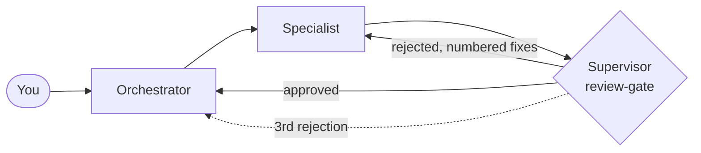

# Antigravity Agent Teams

**Ready-made teams of AI agents organized like real companies, for Google Antigravity.**
Specialists produce, supervisors approve or reject, and an orchestrator coordinates. Built to work with limited quota (e.g. a paid Gemini Pro plan, no other subscriptions).

[English](#english) · [Português](#português)

> Community project, not affiliated with Google. Antigravity changes fast: check its current documentation for folder names and commands.

---

## English

### Teams

| Folder | Team | Agents | Commands |
|--------|------|--------|----------|
| [`software-company`](teams/software-company) | Software company | 13 | /ciclo, /hotfix, /revisar |
| `game-studio` *(Coming soon)* | Game studio | 14 | /conceito, /sprint, /vertical-slice, /playtest |
| `marketing-agency` *(Coming soon)* | Marketing & content agency | 13 | /onboarding-de-cliente, /campanha, /conteudo-semanal, /relatorio-mensal |
| `startup` *(Coming soon)* | Full startup | 16 | /validar-ideia, /mvp, /lancamento, /reuniao-do-conselho |
| `online-store` *(Coming soon)* | Online store (e-commerce) | 15 | /lancar-produto, /campanha-sazonal, /rotina-semanal, /auditoria-da-loja |

### How it works



- Every deliverable goes through the same **`review-gate`**: `APPROVED`, `APPROVED WITH RESERVATIONS` or `REJECTED` (with numbered, actionable fixes). Maximum 2 rejections per deliverable; on the 3rd the orchestrator decides or asks you.
- Specialists write a **handoff** with what was done, assumptions, risks and how to verify. Reviewers read only the brief, the criteria, the artifact and the handoff.
- Workflows pause for a **human checkpoint** before the most expensive step.

### Using a team

Each team is self-contained. The Antigravity workspace must be the **team folder**, not the repository root (the root has no `.agents/`).

1. Clone this repo and open `teams/<team>` in Antigravity, **or** copy that team's `.agents/`, `work/` and `AGENTS.md` into your own project.
2. Fill in the "Preencha antes de começar" block in `.agents/AGENTS.md`.
3. Run a workflow, e.g. `/campanha-sazonal ...` in `online-store`.

```bash
git clone <this-repo-url>
python shared/validate_all.py     # checks every team
```

### What agents do and don't do

They draft, analyze (from data **you** provide), specify, review and plan. They do **not** publish, spend money, message customers, deploy to production or access your accounts, and they do not replace a lawyer, accountant or financial advisor. Agents that "make" art/audio/images write specifications; production happens elsewhere.

### Quota tips

One agent at a time, advanced model only for orchestrator and supervisors, start with a minimal team. See [docs/quota-tips.md](docs/quota-tips.md).

### Language

The team content (agents, skills, workflows) is in **Brazilian Portuguese**. Ask Gemini to translate the markdown files keeping the frontmatter intact; see [docs/customizing.md](docs/customizing.md). Translations are welcome as PRs.

### Compatibility and limitations

- Structure follows the documented Antigravity conventions (`.agents/` with rules, skills, subagents, workflows). If your version uses other names, rename; it's plain markdown.
- `suggested_model` is a hint only; pick the model in the UI.
- Without native subagent delegation, `AGENTS.md` tells the main agent to take each role in turn.
- AI agents make mistakes; the reviewer lowers the risk, it doesn't remove it. Read what matters before publishing or acting.

---

## Português

### Times

| Pasta | Time | Agentes | Comandos |
|-------|------|---------|----------|
| [`software-company`](teams/software-company) | Empresa de Software | 13 | /ciclo, /hotfix, /revisar |
| `game-studio` *(Em breve)* | Estúdio de Jogos | 14 | /conceito, /sprint, /vertical-slice, /playtest |
| `marketing-agency` *(Em breve)* | Agência de Marketing e Conteúdo | 13 | /onboarding-de-cliente, /campanha, /conteudo-semanal, /relatorio-mensal |
| `startup` *(Em breve)* | Startup Completa | 16 | /validar-ideia, /mvp, /lancamento, /reuniao-do-conselho |
| `online-store` *(Em breve)* | Loja Virtual (e-commerce) | 15 | /lancar-produto, /campanha-sazonal, /rotina-semanal, /auditoria-da-loja |

### Como funciona

- Todo artefato passa pelo mesmo **`review-gate`**: `APROVADO`, `APROVADO COM RESSALVAS` ou `REJEITADO` (com correções numeradas). No máximo 2 rejeições por entrega; na 3ª o orquestrador decide ou pergunta a você.
- Especialistas escrevem um **handoff** com o que foi feito, suposições, riscos e como verificar. Revisores leem só briefing, critérios, artefato e handoff.
- Os workflows pausam em um **checkpoint humano** antes da etapa mais cara.

### Como usar um time

Cada time funciona sozinho. O workspace do Antigravity deve ser a **pasta do time**, e não a raiz do repositório (a raiz não tem `.agents/`).

1. Clone o repositório e abra `teams/<time>` no Antigravity, **ou** copie `.agents/`, `work/` e `AGENTS.md` do time para o seu projeto.
2. Preencha o bloco "Preencha antes de começar" em `.agents/AGENTS.md`.
3. Rode um workflow, por exemplo `/campanha-sazonal ...` em `online-store`.

```bash
git clone <url-do-repositorio>
python shared/validate_all.py     # valida todos os times
```

### O que os agentes fazem e não fazem

Redigem, analisam (com dados que **você** fornecer), especificam, revisam e planejam. **Não** publicam, não gastam dinheiro, não falam com clientes, não fazem deploy em produção nem acessam suas contas, e não substituem advogado, contador ou consultor financeiro. Agentes de arte, áudio e imagem escrevem especificações; a produção é feita fora.

### Economia de cota

Um agente por vez, modelo avançado só no orquestrador e nos supervisores, comece com o time mínimo. Veja [docs/quota-tips.pt-BR.md](docs/quota-tips.pt-BR.md) e [docs/customizing.pt-BR.md](docs/customizing.pt-BR.md).

---

## Repository layout

```
teams/<team>/         self-contained team (.agents/, work/, AGENTS.md, README.md, CUSTOMIZING.md)
shared/               common skills and templates + validate / sync scripts
docs/                 quota tips, customizing, creating a new team
```

## Contributing

PRs welcome: new teams, workflows, translations and compatibility fixes. See [CONTRIBUTING.md](CONTRIBUTING.md).

## License

MIT
