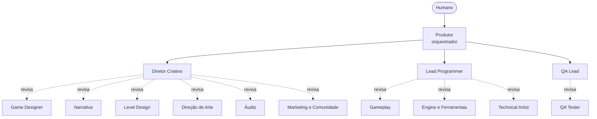

# Estúdio de Jogos com Agentes para o Google Antigravity

Uma equipe de agentes de IA organizada como um estúdio de jogos, para rodar no **Google Antigravity**: designers, programadores, arte, áudio e QA produzem; três supervisores aprovam ou rejeitam; um produtor coordena. Feito para funcionar bem em planos com cota limitada e funciona com qualquer engine.

> Projeto da comunidade, sem vínculo com o Google. O Antigravity muda rápido: confira a documentação atual para nomes de pastas e comandos (veja "Compatibilidade").

## Como funciona



Cada entrega passa pelo `review-gate`:

- **APROVADO**: segue.
- **APROVADO COM RESSALVAS**: segue, e as ressalvas vão para o backlog.
- **REJEITADO**: volta ao autor com correções numeradas. Máximo de 2 rejeições; na 3ª o produtor corta escopo ou pergunta a você.

## Equipe (14 agentes)

| Disciplina | Especialistas | Supervisor |
|-----------|---------------|------------|
| Criação | Game Designer, Narrativa, Level Design, Direção de Arte, Áudio, Marketing e Comunidade | Diretor Criativo |
| Engenharia | Gameplay, Engine e Ferramentas, Technical Artist | Lead Programmer |
| Qualidade | QA Tester | QA Lead |
| Coordenação | | Produtor |

## O que os agentes fazem (e não fazem)

Fazem: design, texto, especificação de assets, código, integração, testes e comunicação.

**Não produzem arte final nem áudio.** Os agentes de arte e áudio escrevem guias de estilo e especificações precisas (veja a skill `asset-spec`); você, artistas ou ferramentas de sua escolha produzem os arquivos. Enquanto isso o jogo roda com placeholders. Testes de jogo só acontecem se o agente conseguir executar o jogo no ambiente; caso contrário ele avisa e faz análise estática.

## Instalação

Esta pasta faz parte do repositório [antigravity-agent-teams](../../README.md). Duas formas de usar:

1. Abra **esta pasta** (`teams/game-studio`) como workspace no Antigravity; ou
2. Copie `.agents/`, `work/` e `AGENTS.md` desta pasta para a raiz do seu projeto.

Antes de começar, edite o bloco "Preencha antes de começar" em `.agents/AGENTS.md`. Para conferir a estrutura: `python ../../shared/validate.py .` (a partir desta pasta). O conteúdo está em português do Brasil.

## Uso

| Comando | O que faz |
|---------|-----------|
| `/conceito` | Ideia vira pilares, pitch, premissa e guia de estilo inicial |
| `/sprint` | Entrega uma mecânica: GDD, código, integração, teste e revisão |
| `/vertical-slice` | Produz uma fatia jogável que mostra o jogo inteiro |
| `/playtest` | Testa uma build e converte achados em correções e ajustes de design |

Exemplo: `/conceito Quero um roguelike de cartas em que o baralho é uma cidade.`

O fluxo pausa antes de gastar cota com código para você aprovar o que será construído.

## Estrutura

```
.agents/
  AGENTS.md          contexto, regras e hierarquia
  subagents/<nome>/AGENT.md
  skills/<nome>/SKILL.md
  workflows/<nome>.md
work/                artefatos de cada ciclo + modelos
CUSTOMIZING.md       como adaptar esta equipe
```

## Economia de cota

Veja [../../docs/quota-tips.pt-BR.md](../../docs/quota-tips.pt-BR.md). Resumo: um agente por vez, modelo avançado só no produtor e nos supervisores, e comece com o time pequeno descrito em [CUSTOMIZING.md](CUSTOMIZING.md).

## Compatibilidade

- A estrutura segue as convenções documentadas do Antigravity (`.agents/` com regras, skills, subagentes e workflows). Se a sua versão usar outros nomes, renomeie; o conteúdo é markdown comum.
- O campo `suggested_model` é só uma dica. O modelo se escolhe na interface.
- Sem delegação nativa a subagentes, o `AGENTS.md` instrui o agente principal a assumir cada papel em sequência.

## Limitações

- Números de balanceamento gerados são hipóteses; só o playtest com pessoas diz se o jogo é divertido.
- Agentes de IA erram. O revisor reduz o risco, não o elimina.
- Respeite direitos autorais ao produzir assets e registre licenças.

## Contribuindo

PRs são bem-vindos: novas disciplinas, workflows por engine, traduções e correções de compatibilidade. Rode `python shared/validate_all.py` na raiz do repositório antes de enviar.

## Licença

MIT
