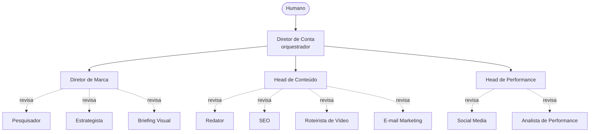

# Agência de Marketing e Conteúdo com Agentes para o Google Antigravity

Uma agência de IA para o **Google Antigravity**: pesquisador, estrategista, redator, SEO, vídeo, e-mail, redes e analista produzem; três supervisores aprovam ou rejeitam; um diretor de conta coordena. Feita para funcionar bem em planos com cota limitada.

> Projeto da comunidade, sem vínculo com o Google. O Antigravity muda rápido: confira a documentação atual para nomes de pastas e comandos (veja "Compatibilidade").

## Como funciona



Cada entrega passa pelo `review-gate`:

- **APROVADO**: segue para a próxima etapa.
- **APROVADO COM RESSALVAS**: segue, e as ressalvas vão para o backlog.
- **REJEITADO**: volta ao autor com correções numeradas. Máximo de 2 rejeições; na 3ª o orquestrador decide ou pergunta a você.

## Equipe (13 agentes)

| Área | Especialistas | Supervisor |
|------|---------------|------------|
| Marca e estratégia | Pesquisador de Mercado, Estrategista, Briefing Visual | Diretor de Marca |
| Conteúdo | Redator, SEO, Roteirista de Vídeo, E-mail Marketing | Head de Conteúdo |
| Performance | Social Media, Analista de Performance | Head de Performance |
| Coordenação | | Diretor de Conta |

## Instalação

Esta pasta faz parte do repositório [antigravity-agent-teams](../../README.md). Duas formas de usar:

1. Abra **esta pasta** (`teams/marketing-agency`) como workspace no Antigravity; ou
2. Copie `.agents/`, `work/` e `AGENTS.md` desta pasta para a raiz do seu projeto.

Antes de começar, edite o bloco "Preencha antes de começar" em `.agents/AGENTS.md`. Para conferir a estrutura: `python ../../shared/validate.py .` (a partir desta pasta). O conteúdo está em português do Brasil.

## Uso

| Comando | O que faz |
|---------|-----------|
| `/onboarding-de-cliente` | Perfil de público, posicionamento e guia de voz e tom |
| `/campanha` | Campanha completa: pesquisa, estratégia, peças por canal e medição |
| `/conteudo-semanal` | Calendário da semana, texto principal, posts e e-mail |
| `/relatorio-mensal` | Relatório de resultados a partir dos seus dados e ajustes do mês seguinte |

Exemplo: `/campanha Lançar a nova linha de cosméticos veganos em dezembro, orçamento de R$ 5.000.`

O fluxo pausa antes da etapa mais cara para você aprovar o rumo.

## O que os agentes fazem (e não fazem)

Fazem: pesquisa a partir de fontes e dados fornecidos, estratégia, textos, roteiros, e-mails, calendário, análise de resultados e briefings visuais.

Não fazem: publicar, enviar e-mails, mexer em contas de anúncios, acessar seu analytics ou produzir imagens e vídeos finais. Tudo passa por você.

## Estrutura

```
.agents/
  AGENTS.md          contexto, regras e hierarquia
  subagents/<nome>/AGENT.md
  skills/<nome>/SKILL.md
  workflows/<nome>.md
work/                artefatos de cada ciclo + modelos
CUSTOMIZING.md       como adaptar esta equipe
```

## Economia de cota

Veja [../../docs/quota-tips.pt-BR.md](../../docs/quota-tips.pt-BR.md). Resumo: um agente por vez, modelo avançado só no orquestrador e nos supervisores, equipe mínima para começar.

## Compatibilidade

- A estrutura segue as convenções documentadas do Antigravity (`.agents/` com regras, skills, subagentes e workflows). Se a sua versão usar outros nomes, renomeie; o conteúdo é markdown comum.
- O campo `suggested_model` é só uma dica. O modelo se escolhe na interface.
- Sem delegação nativa a subagentes, o `AGENTS.md` instrui o agente principal a assumir cada papel em sequência.

## Limitações

- Estatísticas de mercado só valem com fonte. O pesquisador rotula o que é hipótese, mas confira antes de usar publicamente.
- O `checklist-de-conteudo` ajuda com conformidade, mas não é assessoria jurídica (publicidade, LGPD, direitos autorais).
- Agentes de IA erram. O revisor reduz o risco, não o elimina: leia o que importa antes de publicar ou agir.

## Contribuindo

PRs são bem-vindos: novos papéis, workflows, traduções e correções de compatibilidade. Rode `python shared/validate_all.py` na raiz do repositório antes de enviar.

## Licença

MIT
