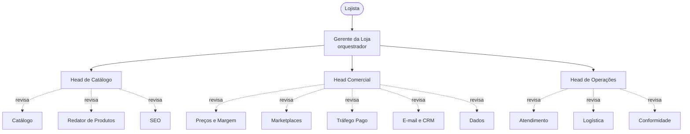

# Loja Virtual (E-commerce) com Agentes para o Google Antigravity

O time de uma loja virtual para o **Google Antigravity**: catálogo, preços, marketplaces, anúncios, CRM, atendimento, logística e conformidade, sob um gerente, com três supervisores que aprovam ou rejeitam cada entrega. As contas de margem são mostradas e conferidas antes de qualquer preço ou promoção.

> Projeto da comunidade, sem vínculo com o Google. O Antigravity muda rápido: confira a documentação atual para nomes de pastas e comandos (veja "Compatibilidade").

## Como funciona



Cada entrega passa pelo `review-gate`:

- **APROVADO**: segue para a próxima etapa.
- **APROVADO COM RESSALVAS**: segue, e as ressalvas vão para o backlog.
- **REJEITADO**: volta ao autor com correções numeradas. Máximo de 2 rejeições; na 3ª o orquestrador decide ou pergunta a você.

## Equipe (15 agentes)

| Área | Especialistas | Supervisor |
|------|---------------|------------|
| Catálogo | Catálogo, Redator de Produtos, SEO | Head de Catálogo |
| Comercial | Preços e Margem, Marketplaces, Tráfego Pago, E-mail e CRM, Dados | Head Comercial |
| Operações | Atendimento, Logística, Conformidade | Head de Operações |
| Coordenação | | Gerente da Loja |

## Instalação

Esta pasta faz parte do repositório [antigravity-agent-teams](../../README.md). Duas formas de usar:

1. Abra **esta pasta** (`teams/online-store`) como workspace no Antigravity; ou
2. Copie `.agents/`, `work/` e `AGENTS.md` desta pasta para a raiz do seu projeto.

Antes de começar, edite o bloco "Preencha antes de começar" em `.agents/AGENTS.md`. Para conferir a estrutura: `python ../../shared/validate.py .` (a partir desta pasta). O conteúdo está em português do Brasil.

## Uso

| Comando | O que faz |
|---------|-----------|
| `/lancar-produto` | Do cadastro à publicação: ficha, descrição, SEO, preço, canais e conformidade |
| `/campanha-sazonal` | Black Friday, Natal e outras datas: ofertas com margem, estoque, anúncios, CRM e atendimento |
| `/rotina-semanal` | Relatório da semana e ajustes de preços, anúncios, estoque e atendimento |
| `/auditoria-da-loja` | Revisão independente de catálogo, preços, conformidade e atendimento |

Exemplo: `/campanha-sazonal Black Friday, orçamento de anúncios de R$ 3.000, 40 produtos candidatos (planilha anexa).`

O fluxo pausa antes da etapa mais cara para você aprovar o rumo.

## O que os agentes fazem (e não fazem)

Fazem: fichas e descrições fiéis aos dados, SEO, cálculo de preço e margem, simulação de promoções, anúncios com teto de custo, fluxos de CRM, playbook de atendimento, planejamento de estoque e prazos, revisão de conformidade e análise dos dados que você fornecer.

Não fazem: publicar, mudar preço ao vivo, ativar anúncios, enviar mensagens, responder clientes, acessar sua plataforma ou substituir contador e advogado.

## Estrutura

```
.agents/
  AGENTS.md          contexto, regras e hierarquia
  subagents/<nome>/AGENT.md
  skills/<nome>/SKILL.md
  workflows/<nome>.md
work/                artefatos de cada ciclo + modelos
CUSTOMIZING.md       como adaptar esta equipe
```

## Economia de cota

Veja [../../docs/quota-tips.pt-BR.md](../../docs/quota-tips.pt-BR.md). Resumo: um agente por vez, modelo avançado só no orquestrador e nos supervisores, equipe mínima para começar.

## Compatibilidade

- A estrutura segue as convenções documentadas do Antigravity (`.agents/` com regras, skills, subagentes e workflows). Se a sua versão usar outros nomes, renomeie; o conteúdo é markdown comum.
- O campo `suggested_model` é só uma dica. O modelo se escolhe na interface.
- Sem delegação nativa a subagentes, o `AGENTS.md` instrui o agente principal a assumir cada papel em sequência.

## Limitações

- Dado de produto ausente fica `A CONFIRMAR`; os agentes não completam medidas, garantias ou certificações por conta própria. Confira as fichas antes de publicar.
- Os cálculos de preço dependem dos percentuais de imposto e taxa que você informar, e as regras dos marketplaces mudam: confirme na central do vendedor.
- O checklist de conformidade e os rascunhos de políticas não são assessoria jurídica.
- Agentes de IA erram. O revisor reduz o risco, não o elimina: leia o que importa antes de publicar ou agir.

## Contribuindo

PRs são bem-vindos: novos papéis, workflows, traduções e correções de compatibilidade. Rode `python shared/validate_all.py` na raiz do repositório antes de enviar.

## Licença

MIT
