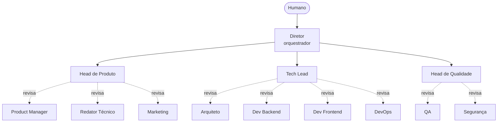

# Empresa de Software com Agentes para o Google Antigravity

Uma equipe de agentes de IA organizada como uma empresa, para rodar no **Google Antigravity**: especialistas produzem, supervisores aprovam ou rejeitam, e um diretor coordena tudo. Feito para funcionar bem em planos com cota limitada.

> Projeto da comunidade, sem vínculo com o Google. O Antigravity muda rápido: confira a documentação atual para nomes de pastas e comandos (veja "Compatibilidade").

## Como funciona



Cada entrega passa por um portão de revisão (`review-gate`):

- **APROVADO**: segue para a próxima etapa.
- **APROVADO COM RESSALVAS**: segue, e as ressalvas vão para o backlog.
- **REJEITADO**: volta ao autor com correções numeradas. Máximo de 2 rejeições; na 3ª o diretor decide ou pergunta a você.

## Equipe (13 agentes)

| Área | Especialistas | Supervisor |
|------|---------------|------------|
| Produto e comunicação | Product Manager, Redator Técnico, Marketing | Head de Produto |
| Engenharia | Arquiteto, Dev Backend, Dev Frontend, DevOps | Tech Lead |
| Qualidade | QA, Segurança | Head de Qualidade |
| Coordenação | | Diretor |

## Instalação

Esta pasta faz parte do repositório [antigravity-agent-teams](../../README.md). Duas formas de usar:

1. Abra **esta pasta** (`teams/software-company`) como workspace no Antigravity; ou
2. Copie `.agents/`, `work/` e `AGENTS.md` desta pasta para a raiz do seu projeto.

Antes de começar, edite o bloco "Preencha antes de começar" em `.agents/AGENTS.md`. Para conferir a estrutura: `python ../../shared/validate.py .` (a partir desta pasta). O conteúdo está em português do Brasil.

## Uso

| Comando | O que faz |
|---------|-----------|
| `/ciclo` | Da ideia ao lançamento: spec, design, código, QA, segurança, deploy e comunicação |
| `/hotfix` | Corrige um defeito com o menor caminho e revisão |
| `/revisar` | Revisão independente de algo existente, sem alterar código |

Exemplo: `/ciclo Quero um app de lista de tarefas com login e compartilhamento de listas.`

O fluxo pausa depois do design para você aprovar antes de gastar cota com implementação.

## Estrutura

```
.agents/
  AGENTS.md          contexto, regras e hierarquia
  subagents/<nome>/AGENT.md
  skills/<nome>/SKILL.md
  workflows/<nome>.md
work/                artefatos de cada ciclo + modelos
CUSTOMIZING.md       como adaptar esta equipe
```

## Economia de cota

Veja [../../docs/quota-tips.pt-BR.md](../../docs/quota-tips.pt-BR.md). Resumo: um agente por vez, modelo avançado só no diretor e nos supervisores, equipe mínima para começar.

## Compatibilidade

- A estrutura segue as convenções documentadas do Antigravity (`.agents/` com regras, skills, subagentes e workflows). Se a sua versão usar outros nomes de pasta ou formato, renomeie; o conteúdo é markdown comum.
- O campo `suggested_model` é só uma dica. O modelo se escolhe na interface.
- Se a delegação nativa a subagentes não estiver disponível no seu plano, o `AGENTS.md` instrui o agente principal a assumir cada papel em sequência. O resultado é o mesmo, só que em uma única sessão.

## Limitações

- Agentes de IA erram. O revisor reduz o risco, não o elimina: leia o que importa antes de ir para produção.
- Nada aqui faz deploy sozinho: produção sempre pede o seu OK.

## Contribuindo

PRs são bem-vindos: novos papéis, workflows, traduções e correções de compatibilidade. Rode `python shared/validate_all.py` na raiz do repositório antes de enviar.

## Licença

MIT
