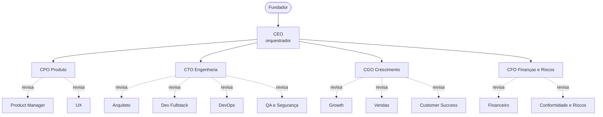

# Startup Completa com Agentes para o Google Antigravity

Uma startup de IA para o **Google Antigravity**: produto, engenharia, crescimento e finanças trabalham sob um CEO, e quatro supervisores aprovam ou rejeitam cada entrega. Vai da validação da ideia ao MVP e ao lançamento, com checkpoints para você, o fundador, decidir.

> Projeto da comunidade, sem vínculo com o Google. O Antigravity muda rápido: confira a documentação atual para nomes de pastas e comandos (veja "Compatibilidade").

## Como funciona



Cada entrega passa pelo `review-gate`:

- **APROVADO**: segue para a próxima etapa.
- **APROVADO COM RESSALVAS**: segue, e as ressalvas vão para o backlog.
- **REJEITADO**: volta ao autor com correções numeradas. Máximo de 2 rejeições; na 3ª o orquestrador decide ou pergunta a você.

## Equipe (16 agentes)

| Área | Especialistas | Supervisor |
|------|---------------|------------|
| Produto | Product Manager, UX Designer | CPO |
| Engenharia | Arquiteto, Dev Fullstack, DevOps, QA e Segurança | CTO |
| Crescimento | Growth Marketer, Vendas, Customer Success | CGO |
| Finanças e riscos | Analista Financeiro, Conformidade e Riscos | CFO |
| Coordenação | | CEO |

## Instalação

Esta pasta faz parte do repositório [antigravity-agent-teams](../../README.md). Duas formas de usar:

1. Abra **esta pasta** (`teams/startup`) como workspace no Antigravity; ou
2. Copie `.agents/`, `work/` e `AGENTS.md` desta pasta para a raiz do seu projeto.

Antes de começar, edite o bloco "Preencha antes de começar" em `.agents/AGENTS.md`. Para conferir a estrutura: `python ../../shared/validate.py .` (a partir desta pasta). O conteúdo está em português do Brasil.

## Uso

| Comando | O que faz |
|---------|-----------|
| `/validar-ideia` | Hipóteses, canvas, experimentos, modelo financeiro e riscos, até uma recomendação de seguir, ajustar ou parar |
| `/mvp` | Spec, UX, arquitetura, código, testes e deploy do MVP |
| `/lancamento` | Go-to-market, vendas, onboarding, suporte e documentos legais |
| `/reuniao-do-conselho` | Revisão mensal com seus números e decisões do próximo mês |

Exemplo: `/validar-ideia Quero um app de assinatura de marmitas saudáveis para escritórios pequenos.`

O fluxo pausa antes da etapa mais cara para você aprovar o rumo.

## O que os agentes fazem (e não fazem)

Fazem: estruturar hipóteses, desenhar experimentos, modelar números com premissas explícitas, especificar, construir e testar o MVP, preparar vendas, suporte e rascunhos legais.

Não fazem: falar com clientes, publicar, gastar, ir ao ar em produção ou substituir contador e advogado. A validação real acontece com você indo ao mercado; os agentes preparam e interpretam.

## Estrutura

```
.agents/
  AGENTS.md          contexto, regras e hierarquia
  subagents/<nome>/AGENT.md
  skills/<nome>/SKILL.md
  workflows/<nome>.md
work/                artefatos de cada ciclo + modelos
CUSTOMIZING.md       como adaptar esta equipe
```

## Economia de cota

Veja [../../docs/quota-tips.pt-BR.md](../../docs/quota-tips.pt-BR.md). Resumo: um agente por vez, modelo avançado só no orquestrador e nos supervisores, equipe mínima para começar.

## Compatibilidade

- A estrutura segue as convenções documentadas do Antigravity (`.agents/` com regras, skills, subagentes e workflows). Se a sua versão usar outros nomes, renomeie; o conteúdo é markdown comum.
- O campo `suggested_model` é só uma dica. O modelo se escolhe na interface.
- Sem delegação nativa a subagentes, o `AGENTS.md` instrui o agente principal a assumir cada papel em sequência.

## Limitações

- Todo número de mercado ou financeiro vem rotulado como fato (com fonte) ou hipótese. Revise as premissas antes de decidir algo importante.
- Documentos legais são rascunhos para um advogado revisar. Análise financeira apoia a decisão, não é consultoria.
- Agentes de IA erram. O revisor reduz o risco, não o elimina: leia o que importa antes de publicar ou agir.

## Contribuindo

PRs são bem-vindos: novos papéis, workflows, traduções e correções de compatibilidade. Rode `python shared/validate_all.py` na raiz do repositório antes de enviar.

## Licença

MIT
